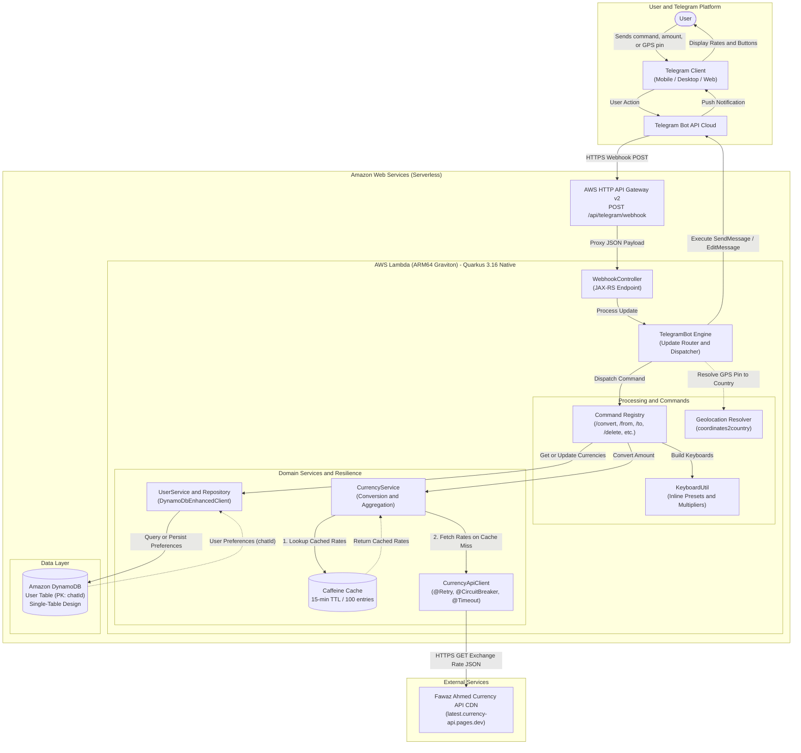
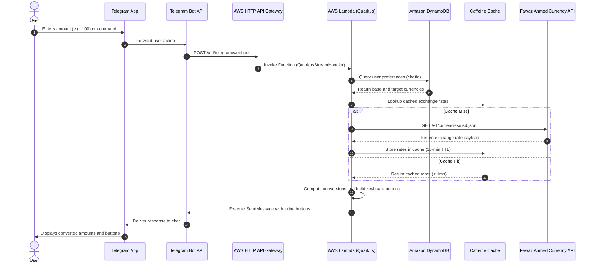

<div align="center">

# Telegram Currency Conversion Bot

[](https://github.com/649000/currency-coinverter-bot/actions/workflows/ci.yml)
[](https://github.com/649000/currency-coinverter-bot/actions/workflows/codeql.yml)
[](https://github.com/649000/currency-coinverter-bot/actions/workflows/ci.yml)


<p>
An event-driven serverless Telegram bot for real-time multi-currency conversions with geolocation resolution and interactive controls. Built with Quarkus 3.16, compiled to an ARM64 Linux native binary with GraalVM for sub-150ms cold starts on AWS Lambda, backed by Amazon DynamoDB, and provisioned with AWS Cloud Development Kit (CDK v2).
</p>

<p>
  <a href="https://t.me/CurrencyCoinvertBot">Telegram Bot</a> &bull;
  <a href="docs/ci-cd-guide.md">CI/CD Guide</a> &bull;
  <a href="#architecture">Architecture</a> &bull;
  <a href="#getting-started">Getting Started</a>
</p>

</div>

---

## Table of Contents

- [Features](#features)
- [Usage and Commands](#usage-and-commands)
  - [Available Commands](#available-commands)
  - [Example Interaction](#example-interaction)
- [Architecture](#architecture)
  - [System Architecture Diagram](#system-architecture-diagram)
  - [Request Lifecycle](#request-lifecycle)
  - [Component Overview](#component-overview)
- [Technology Stack](#technology-stack)
- [Project Structure](#project-structure)
- [Getting Started](#getting-started)
  - [Prerequisites](#prerequisites)
  - [Environment Configuration](#environment-configuration)
  - [Local Testing and Development](#local-testing-and-development)
  - [Packaging Function Artifacts](#packaging-function-artifacts)
  - [Deployment with AWS CDK](#deployment-with-aws-cdk)
- [CI/CD and Security Architecture](#cicd-and-security-architecture)
- [Architectural Decisions and Learnings](#architectural-decisions-and-learnings)

---

## Features

- **Sub-second serverless execution**: Compiles with GraalVM Native Image to run as an ARM64 Linux binary (`provided.al2023`) on AWS Lambda, achieving sub-150ms cold start latency with zero idle compute cost.
- **Real-time currency conversion**: Retrieves exchange rates for over 150 fiat currencies and commodities via the Fawaz Ahmed Currency API CDN, converting a base currency to multiple target currencies simultaneously.
- **Geolocation and country resolution**: Accepts ISO currency codes, English country names, or Telegram GPS location pins, which are resolved offline to country codes via `coordinates2country`.
- **Fault-tolerant caching**: Uses a 15-minute in-memory Caffeine cache alongside SmallRye Fault Tolerance policies (circuit breaker, retry, and timeout) to maintain availability during upstream failures.
- **Inline keyboard controls**: Provides Telegram inline keyboards for quick amount presets (1, 25, 100, 500), multipliers (0.5x, 2x, 5x, 10x), and target currency deletion.
- **Infrastructure as Code**: Provisions all cloud resources (HTTP API Gateway v2, Lambda, DynamoDB, and IAM policies) in Java using AWS CDK v2 for compile-time validation and repeatable deployments.

---

## Usage and Commands

### Available Commands

| Command | Parameters | Description | Example |
|---|---|---|---|
| `/start` | None | Displays the welcome onboarding message and setup instructions | `/start` |
| `/from` | `<currency \| country>` | Sets the base source currency by ISO code, country name, or GPS pin | `/from USD` or `/from Japan` |
| `/to` | `<currency \| country>` | Adds a target conversion currency (up to 3 targets) | `/to SGD` or `/to Singapore` |
| `/convert` | `<amount>` | Converts an amount to all saved target currencies | `/convert 250.50` |
| `<number>` | None | Direct input shortcut to execute conversion immediately | `100` |
| `/getcurrencies` | None | Displays current base and target currency configurations | `/getcurrencies` |
| `/deletecurrency` | None | Displays inline buttons to remove saved target currencies | `/deletecurrency` |
| `/help` | None | Displays command usage and reference guide | `/help` |

### Example Interaction

```text
User:
100

Currency Coinverter Bot:
100.00 USD (United States Dollar)

134.50 SGD (Singapore Dollar)
92.15 EUR (Euro)
15,230.00 JPY (Japanese Yen)

[ 0.5x ]  [ 2x ]  [ 5x ]  [ 10x ]
[  1   ]  [ 25 ]  [ 100 ]  [ 500 ]
```

Users can also share a Telegram GPS location pin directly in the chat, which automatically configures the base currency corresponding to the detected country.

---

## Architecture

The system operates as an event-driven serverless application designed for low latency, fault tolerance, and zero idle operational cost.

### System Architecture Diagram



### Request Lifecycle



### Component Overview

1. **Ingress (API Gateway v2)**: AWS HTTP API Gateway terminates HTTPS connections and forwards webhook payloads from `/api/telegram/webhook` to the Lambda function.
2. **Compute (Quarkus Native on AWS Lambda)**:
   - `WebhookController`: JAX-RS endpoint receiving API Gateway HTTP events.
   - `TelegramBot`: Event processing engine that handles text commands, numerical inputs, location updates, and inline button callbacks.
   - `CommandRegistry`: Command Pattern implementation dispatching updates to specific command handlers (`StartCommand`, `FromCurrencyCommand`, `ToCurrencyCommand`, `ConvertCommand`, `DeleteCurrencyCommand`, `GetCurrenciesCommand`, `HelpCommand`).
   - `Geolocation Resolver`: Uses `coordinates2country` to translate latitude and longitude coordinates into ISO country codes offline without external network overhead.
3. **Resilience and Caching**:
   - `Caffeine Cache`: Caches rate tables in Lambda memory for 15 minutes (`@CacheResult(cacheName = "exchange-rates")`), eliminating redundant external requests.
   - `MicroProfile Fault Tolerance`: Protects outbound API calls using `@Retry` (3 attempts with 1000ms delay), `@CircuitBreaker` (trips at 50% failure ratio across 4 invocations), and `@Timeout` (10-second limit).
4. **Persistence (Amazon DynamoDB)**:
   - Persists user preferences (`chatId`, `baseCurrency`, `targetCurrencies`, `updatedAt`) using a single-table design with `chatId` as the partition key.
   - Accessed through the AWS SDK v2 `DynamoDbEnhancedClient` backed by the lightweight URL connection client.

---

## Technology Stack

| Layer | Component | Technology | Role and Purpose |
|---|---|---|---|
| Language and Runtime | Programming Language | Java 21 (LTS) | LTS release with modern language features and virtual thread support |
| | Native Compilation | GraalVM / Mandrel 21 | Ahead-of-Time compilation eliminating JVM warmup and reducing cold starts |
| Framework | Core Application | Quarkus 3.16 | Lightweight Java framework tailored for container and serverless runtimes |
| | Dependency Injection | Quarkus ArC | Build-time dependency injection and bean discovery |
| | Caching | Quarkus Cache (Caffeine) | In-memory cache with 15-minute TTL and automatic cache key generation |
| | Fault Tolerance | SmallRye Fault Tolerance | Circuit breaker, retry, and timeout policies for network resilience |
| | REST Client | Quarkus REST Client Jackson | Declarative HTTP client for exchange rate retrieval |
| Cloud and Hosting | Compute | AWS Lambda (ARM64) | Event-driven execution on AWS Graviton processors (`provided.al2023`) |
| | Ingress | AWS HTTP API Gateway (v2) | Low-latency HTTP routing for webhook delivery |
| | Database | Amazon DynamoDB | Managed NoSQL storage with single-table design |
| | Cloud SDK | AWS SDK for Java v2 | DynamoDB Enhanced Client with lightweight HTTP client |
| Infrastructure as Code | IaC Framework | AWS CDK v2 (Java) | Type-safe cloud infrastructure synthesized to CloudFormation |
| External Integrations | Exchange Rate Data | Fawaz Ahmed Currency API | CDN-backed open currency exchange rate data provider |
| | Bot Platform | Telegram Bot API | Webhook-driven bot communication with inline controls |
| | Geocoding | `coordinates2country` | Offline spatial lookup mapping GPS coordinates to country codes |
| CI/CD and Security | Pipeline Automation | GitHub Actions | Tiered workflow for CI, JVM dev deployment, and native PRD releases |
| | Code Analysis | GitHub CodeQL | Static analysis for semantic vulnerability detection |
| | Cloud Authentication | AWS IAM OpenID Connect (OIDC) | Keyless authentication using temporary STS credentials |

---

## Project Structure

```text
currency-coinverter-bot/
├── .github/
│   ├── badges/                     # JaCoCo test coverage SVG badge assets
│   └── workflows/
│       ├── ci.yml                  # Tier 1: Fast CI (< 1.5m, tests + CDK synth + JaCoCo)
│       ├── codeql.yml              # Automated SAST semantic security scanning
│       ├── deploy-dev.yml          # Tier 2: Automated DEV deployment (JVM mode)
│       └── deploy-prd.yml          # Tier 3: Production native deployment (GraalVM ARM64)
├── cdk/                            # AWS Cloud Development Kit (CDK v2) infrastructure
│   ├── cdk.json                    # CDK app configuration and context defaults
│   ├── pom.xml                     # Maven configuration for CDK constructs
│   └── src/main/java/com/nazri/
│       ├── CdkApp.java             # Main CDK App orchestrating all 3 stacks
│       ├── config/
│       │   └── StackConfig.java    # Environment configurations (DEV vs PRD, GraalVM toggle)
│       ├── stack/
│       │   ├── APIGatewayStack.java# HTTP API Gateway (v2) stack
│       │   ├── DynamoDBStack.java  # DynamoDB single-table persistence stack
│       │   └── LambdaStack.java    # Lambda function stack with ARM64 & runtime toggles
│       └── util/
│           ├── Constant.java       # Resource naming constants and default properties
│           ├── EnvironmentUtil.java# Environment resolution helper
│           └── TagUtil.java        # Standardized AWS resource tagging helper
├── docs/
│   └── ci-cd-guide.md              # In-depth CI/CD architecture, quota, and deployment guide
├── quarkus/                        # Core bot application backend
│   ├── pom.xml                     # Quarkus dependencies and GraalVM build profiles
│   └── src/
│       ├── main/
│       │   ├── java/com/nazri/
│       │   │   ├── client/         # MicroProfile REST client for currency API
│       │   │   ├── command/        # Command Pattern implementations and registry
│       │   │   ├── controller/     # JAX-RS Webhook endpoint (/api/telegram/webhook)
│       │   │   ├── model/          # DynamoDB User entity and Telegram response models
│       │   │   ├── repository/     # DynamoDB Enhanced Client data access layer
│       │   │   ├── service/        # Currency conversion, bot engine, and message formatters
│       │   │   └── util/           # Keyboard builders, ISO currency codes, and helpers
│       │   └── resources/
│       │       ├── application.properties # Quarkus configuration, flags, and rate symbols
│       │       └── messages.properties    # Bot message templates and localization
│       └── test/                   # Unit and integration test suites
├── pom.xml                         # Root Maven parent reactor project
└── README.md                       # Project documentation
```

---

## Getting Started

### Prerequisites

Ensure the following tools are installed in your local development environment:

- Java Development Kit (JDK 21 or higher)
- Apache Maven 3.9 or higher
- Node.js 18 or higher with npm
- AWS CDK CLI v2:
  ```bash
  npm install -g aws-cdk
  ```
- AWS CLI configured with active credentials (`aws configure`)
- Docker (required for GraalVM native container compilation)

### Environment Configuration

The application and CDK stacks read the following environment variables:

| Variable | Description | Example / Default |
|---|---|---|
| `CURRENCYCOINVERTER_TELEGRAM_BOT_USERNAME` | Username of your Telegram Bot | `CurrencyCoinvertBot` |
| `CURRENCYCOINVERTER_TELEGRAM_BOT_TOKEN` | Bot API Token issued by @BotFather | `123456789:ABCdefGhIJKlmNoPQRsTUVwxyZ` |
| `CURRENCYCOINVERTER_TELEGRAM_BOT_URL` | Public HTTPS Webhook endpoint URL | `https://xxxxxx.execute-api.ap-southeast-1.amazonaws.com/api/telegram/webhook` |
| `AWS_REGION` | AWS Deployment Region | `ap-southeast-1` |

### Local Testing and Development

Run unit tests across all Maven modules (CDK constructs and Quarkus application):

```bash
# Run all unit tests
mvn clean test

# Run tests for Quarkus application only
mvn test -pl quarkus
```

To run the Quarkus application locally with live reload:

```bash
cd quarkus
mvn quarkus:dev
```

### Packaging Function Artifacts

#### 1. Fast JVM Mode (for development)
Packages the application in 5 to 10 seconds into `quarkus/target/function.zip`:

```bash
cd quarkus
mvn clean package -DskipTests
```

#### 2. GraalVM Native Image (for production)
Compiles Ahead-Of-Time (AOT) to a standalone Linux ELF executable in Docker:

```bash
cd quarkus
mvn clean package -Dnative -Dquarkus.native.container-build=true -DskipTests
```

### Deployment with AWS CDK

Navigate to the `cdk` directory:

```bash
cd cdk

# List available stacks
cdk list

# Synthesize CloudFormation templates
cdk synth -c env=dev

# Check difference between local definitions and deployed cloud state
cdk diff -c env=dev

# Deploy all stacks to DEV environment (JVM runtime)
cdk deploy --all -c env=dev

# Deploy all stacks to PRD environment (Native ARM64 runtime)
cdk deploy --all -c env=prd
```

---

## CI/CD and Security Architecture

The repository uses a three-tier GitHub Actions pipeline designed for rapid developer feedback and minimal runner minutes:

- **Tier 1: Continuous Integration (`ci.yml`)**: Executes on pushes and pull requests. Runs automated tests (`mvn test`), compiles JVM artifacts, and validates CloudFormation synthesis (`cdk synth`) in under two minutes without running native image builds.
- **Tier 2: Development Deployment (`deploy-dev.yml`)**: Deploys JVM-based Lambda artifacts (`Runtime.JAVA_21`) for rapid functional verification in non-production environments.
- **Tier 3: Production Release (`deploy-prd.yml`)**: Triggers on version tags (`v*.*.*`) or manual dispatch. Compiles ARM64 native executables on native ARM64 runners (`ubuntu-24.04-arm`) to avoid QEMU emulation overhead.
- **Security Scanning (`codeql.yml`)**: Runs GitHub CodeQL static analysis weekly and on pushes to identify security risks.
- **Keyless Authentication**: Assumes temporary AWS IAM roles using OpenID Connect (OIDC), removing the need for persistent AWS access keys.

For complete documentation on pipeline mechanics, quota optimizations, and AWS OIDC configuration, see the [CI/CD Architecture and GitHub Actions Guide](docs/ci-cd-guide.md).

---

## Architectural Decisions and Learnings

### Quarkus over Spring Boot
- **Cold start reduction**: Compiling to native binaries eliminates JVM warmup and class-loading overhead, reducing Lambda cold start times from over 2 seconds to roughly 150 ms.
- **Memory footprint**: The native executable runs within 256 MB to 512 MB memory limits, reducing Lambda execution costs.
- **Serverless integration**: Quarkus provides built-in extensions for AWS Lambda HTTP routing and GraalVM native builds out of the box.

### DynamoDB Single-Table Design
- **Access pattern alignment**: Storing chat settings by `chatId` as partition key fits the access pattern directly without multi-table join overhead.
- **Type-safe mapping**: The AWS SDK v2 `DynamoDbEnhancedClient` provides declarative annotations for entity persistence without manual AttributeValue conversion code.

### AWS CDK in Java
- **Unified language**: Defining infrastructure in Java 21 allows using the same language, toolchains, and IDE features across application and infrastructure code.
- **Compile-time validation**: Infrastructure configurations benefit from static typing, autocompletion, and automated assertion testing.

### Native ARM64 Deployment
- **Graviton efficiency**: Running on ARM64 Graviton instances delivers better cost-to-performance efficiency compared to traditional x86_64 runtimes.
- **Native compilation strategy**: Building directly on ARM64 CI runners avoids cross-architecture QEMU emulation slowdowns, keeping production build times under 5 minutes.
