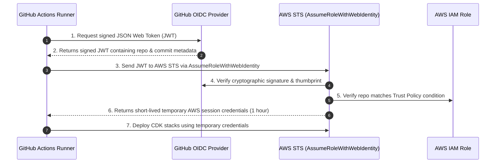

# CI/CD Architecture & GitHub Actions Guide

This guide provides an end-to-end walkthrough of the Continuous Integration and Continuous Deployment (CI/CD) pipelines for the **Currency Coinverter Telegram Bot**. It explains how the **Quarkus backend** and **AWS CDK infrastructure** are automated, how **GraalVM native image compilation** is handled without exhausting GitHub Actions' free limits, and how **AWS IAM OIDC** enables secure passwordless deployments.

---

## Table of Contents

1. [The Challenge: Native Compilation & Free Limits](#1-the-challenge-native-compilation--free-limits)
2. [Pipeline Architecture & Tiered Strategy](#2-pipeline-architecture--tiered-strategy)
3. [Quarkus Compilation: JVM vs Native Image](#3-quarkus-compilation-jvm-vs-native-image)
4. [ARM64 Architecture & Runner Selection](#4-arm64-architecture--runner-selection)
5. [AWS Authentication via OpenID Connect (OIDC)](#5-aws-authentication-via-openid-connect-oidc)
6. [Required GitHub Secrets & Variables](#6-required-github-secrets--variables)
7. [Deployment Playbook: How to Release](#7-deployment-playbook-how-to-release)
8. [Security & SAST Scanning](#8-security--sast-scanning)
9. [Troubleshooting & FAQ](#9-troubleshooting--faq)

---

## 1. The Challenge: Native Compilation & Free Limits

### The Free Limit Reality
- **Public Repositories**: GitHub Actions is **100% free with unlimited minutes** for standard runners.
- **Private Repositories**: Free GitHub accounts receive **2,000 minutes per calendar month** across all private repositories.

### Why GraalVM Native Image Threatens Free Limits
Compiling Java to a native machine executable via GraalVM/Mandrel Ahead-Of-Time (AOT) compilation is computationally heavy:
- It performs aggressive dead-code elimination, points-to analysis, and inlines classes directly into machine code.
- On standard 2-vCPU cloud runners, this takes **4 to 7 minutes** per build.
- If native compilation were triggered on every commit or PR (e.g., 5 commits/day × 20 working days = 100 runs), it would consume **500 to 700 minutes per month** (25%–35% of your entire monthly allowance) and slow down your development cycle with 5-minute wait times for simple PR reviews.

### The ARM64 Emulation Trap
AWS Lambda functions running on AWS Graviton (ARM64) offer better price-performance. In [`cdk/src/main/java/com/nazri/stack/LambdaStack.java`](../cdk/src/main/java/com/nazri/stack/LambdaStack.java):
```java
.architecture(Architecture.ARM_64)
.runtime(Runtime.PROVIDED_AL2023)
```
If an x86 runner compiles an ARM64 binary using QEMU Docker emulation (`docker run --platform linux/arm64`), instruction translation overhead slows compilation by 3–4×, ballooning build times to **15 to 25 minutes**!

---

## 2. Pipeline Architecture & Tiered Strategy

To solve both quota consumption and slow feedback, we divide CI/CD into three distinct tiers:

```mermaid
flowchart TD
    subgraph TIER1["Tier 1: Fast CI (.github/workflows/ci.yml)"]
        A[Pull Request or Feature Branch] --> B[Setup Java 21 + Maven Cache]
        B --> C["Run Tests: mvn test (~10s)"]
        C --> D["Fast JVM Packaging: mvn package (~10s)"]
        D --> E["CDK Synth Validation: cdk synth (~15s)"]
        E --> F["Finished in < 1.5 mins | Quota: Negligible"]
    end

    subgraph TIER2["Tier 2: Continuous DEV Deployment (.github/workflows/deploy-dev.yml)"]
        G[Merge to main] --> H[Setup Java 21 + Maven Cache]
        H --> I["Build JVM Package (~10s)"]
        I --> J["Authenticate via AWS OIDC"]
        J --> K["cdk deploy --all -c env=dev (~2 mins)"]
    end

    subgraph TIER3["Tier 3: Production Native Release (.github/workflows/deploy-prd.yml)"]
        L["Push Git Tag (v*.*.*) or Manual UI Click"] --> M["Run on ubuntu-24.04-arm Runner"]
        M --> N["Setup Mandrel / GraalVM JDK 21"]
        N --> O["Compile Native ARM64 Binary (~4-5 mins)"]
        O --> P["Authenticate via AWS OIDC"]
        P --> Q["cdk deploy --all -c env=prd (~2 mins)"]
    end
```



### Workflow Comparison

| Workflow | File | Trigger | Runtime Mode | Runner | Duration | Quota Impact |
|---|---|---|---|---|---|---|
| **CI** | `.github/workflows/ci.yml` | Push to `main`, PRs, feature branches | JVM (`mvn test`, `cdk synth`) | `ubuntu-latest` | ~1.5 min | ~1.5 min/run |
| **Security (CodeQL SAST)** | `.github/workflows/codeql.yml` | Push/PR to `main`, weekly Sunday cron | AST / Semantic Analysis | `ubuntu-latest` | ~2 min | ~2 min/run (Free on public) |
| **Dependabot (CVE Scanner)** | `.github/dependabot.yml` | Weekly Monday 03:00 SGT | Automated PR generation | GitHub Core | 0 min | 0 minutes (100% free) |
| **Deploy - DEV** | `.github/workflows/deploy-dev.yml` | Manual UI button (`workflow_dispatch`) | JVM (`Runtime.JAVA_21`) | `ubuntu-latest` | ~2.5 min | Only when clicked |
| **Deploy - PRD** | `.github/workflows/deploy-prd.yml` | Tag `v*.*.*` or Manual Button | GraalVM Native (`provided.al2023`) | `ubuntu-24.04-arm` | ~5 min | Only when released |

---

## 3. Quarkus Compilation: JVM vs Native Image

In [`cdk/src/main/java/com/nazri/config/StackConfig.java`](../cdk/src/main/java/com/nazri/config/StackConfig.java), notice how environments are toggled:
- **DEV**: `graalvm = false` → Lambda uses AWS Java 21 managed runtime (`java21`).
- **PRD**: `graalvm = true` → Lambda uses custom Linux runtime (`provided.al2023`) with native binary.

### How Quarkus Packages for Lambda
When running `mvn package` in `quarkus/`:
1. **JVM Mode** (`mvn package -DskipTests`):
   - Compiles `.class` files and packages dependencies into `quarkus/target/function.zip`.
   - Contains `quarkus-app/` and the AWS Lambda handler `QuarkusStreamHandler`.
   - Build time: **5 to 10 seconds**.

2. **Native Mode** (`mvn package -Dnative -DskipTests`):
   - Invokes GraalVM/Mandrel `native-image`.
   - Produces a standalone Linux ELF executable named `runner`.
   - Packages `runner` along with an executable shell script named `bootstrap` into `quarkus/target/function.zip`.
   - Build time: **4 to 6 minutes**.
   - Cold start in Lambda: **~150ms** (vs ~2,000ms on JVM).

Because both modes output to the identical path `../quarkus/target/function.zip`, the CDK asset definition in `LambdaStack.java`:
```java
.code(Code.fromAsset("../quarkus/target/function.zip"))
```
seamlessly works with both!

---

## 4. ARM64 Architecture & Runner Selection

To prevent the 20-minute QEMU emulation penalty when building ARM64 native binaries on GitHub Actions, the production deployment workflow uses:

```yaml
runs-on: ubuntu-24.04-arm
```

GitHub Actions provides 64-bit ARM runners running Ubuntu 24.04. When GraalVM compiles on this runner, it compiles ARM64 code on physical ARM64 hardware without emulation, reducing build time to just **~4 to 5 minutes**.

---

## 5. AWS Authentication via OpenID Connect (OIDC)

Instead of generating permanent AWS IAM Access Keys and saving them in GitHub secrets (which poses a credential leak hazard), GitHub Actions authenticates using **OpenID Connect (OIDC)**.



### One-Time AWS IAM Setup

#### Step 1: Add GitHub as an OIDC Identity Provider in AWS
In your AWS Console:
1. Navigate to **IAM** → **Identity Providers** → **Add Provider**.
2. Select **OpenID Connect**.
3. **Provider URL**: `https://token.actions.githubusercontent.com`
4. **Audience**: `sts.amazonaws.com`
5. Click **Get Thumbprint**, then click **Add Provider**.

*(Alternatively, via AWS CLI)*:
```bash
aws iam create-open-id-connect-provider \
  --url "https://token.actions.githubusercontent.com" \
  --client-id-list "sts.amazonaws.com" \
  --thumbprint-list "6938fd4d98bab03faadb97b34396831e3780aea1" \
  --region ap-southeast-1
```

#### Step 2: Create the IAM Role for GitHub Actions
Create an IAM Role with the following **Trust Policy** (replace `YOUR_AWS_ACCOUNT_ID` and ensure the repo matches `649000/currency-coinverter-bot`):

```json
{
  "Version": "2012-10-17",
  "Statement": [
    {
      "Effect": "Allow",
      "Principal": {
        "Federated": "arn:aws:iam::YOUR_AWS_ACCOUNT_ID:oidc-provider/token.actions.githubusercontent.com"
      },
      "Action": "sts:AssumeRoleWithWebIdentity",
      "Condition": {
        "StringEquals": {
          "token.actions.githubusercontent.com:aud": "sts.amazonaws.com"
        },
        "StringLike": {
          "token.actions.githubusercontent.com:sub": "repo:649000/currency-coinverter-bot:*"
        }
      }
    }
  ]
}
```

Attach the permissions required by AWS CDK deployment (e.g., `AdministratorAccess` or a scoped CDK deployment policy).

---

## 6. Required GitHub Secrets & Variables

Navigate to **GitHub Repository** → **Settings** → **Secrets and variables** → **Actions**.

### Repository Secrets (`Settings` → `Secrets`)
| Secret Name | Description | Example |
|---|---|---|
| `AWS_ROLE_ARN` | The ARN of the IAM Role created in Step 5 | `arn:aws:iam::123456789012:role/GitHubActionsCdkDeployRole` |
| `CURRENCYCOINVERTER_TELEGRAM_BOT_USERNAME` | Your Telegram Bot username | `CurrencyCoinvertBot` |
| `CURRENCYCOINVERTER_TELEGRAM_BOT_TOKEN` | Your Telegram Bot token from @BotFather | `1234567890:ABC-DEF1234ghIkl-zyx57W2v1u123ew11` |
| `CURRENCYCOINVERTER_TELEGRAM_BOT_URL` | The HTTP API Gateway webhook URL | `https://xxxxxx.execute-api.ap-southeast-1.amazonaws.com/api/telegram/webhook` |

### Repository Variables (`Settings` → `Variables`)
| Variable Name | Description | Default |
|---|---|---|
| `AWS_REGION` | The AWS deployment region | `ap-southeast-1` |

### Environment Protection Rules (Approval Gates)
Because this is a public repository, you can enable GitHub's native **Required Reviewers** feature for free:
1. Navigate to **Settings** → **Environments** in your GitHub repository.
2. Click **New environment** and enter `dev`.
3. Check the box for **Required reviewers** and add your GitHub username.
4. Click **Save protection rules**.
5. Repeat the same steps for the `prd` environment.

> [!TIP]
> With **Required Reviewers** enabled, GitHub will pause execution and display a prominent **"Waiting for review"** prompt whenever any deployment job triggers. The job **will never touch AWS** until you personally review and click **"Approve and deploy"**.

---

## 7. Deployment Playbook: How to Release

### Testing Changes in a Pull Request
1. Create a feature branch:
   ```bash
   git checkout -b feat/add-new-command
   ```
2. Commit and push your changes:
   ```bash
   git push origin feat/add-new-command
   ```
3. Open a Pull Request against `main`.
4. The **CI** workflow runs unit tests and CDK synthesis in under ~1.5 minutes.

### Continuous Deployment to DEV
1. Merge the Pull Request into `main`.
2. The **Deploy - DEV** workflow automatically triggers:
   - Compiles Quarkus in fast JVM mode.
   - Deploys the updated stacks to `dev` environment.
   - Total time: ~2.5 minutes.

### Releasing to Production (PRD) with Native Image

#### Option A: Using Git Version Tags (Recommended)
Tag your release and push to GitHub:
```bash
# Create an annotated semantic version tag
git tag -a v1.0.0 -m "Release v1.0.0: Initial production release"

# Push the tag to GitHub
git push origin v1.0.0
```
GitHub Actions will automatically pick up the `v*.*.*` tag, trigger `deploy-prd.yml`, compile the GraalVM ARM64 native image, and deploy to your production AWS environment.

#### Option B: Manual UI Trigger
1. Go to the **Actions** tab in your GitHub repository.
2. In the left sidebar, click **Deploy - Production (Native)**.
3. Click the **Run workflow** dropdown button.
4. Keep the confirmation text as `deploy`.
5. Click **Run workflow**.

---

## 8. Security & SAST Scanning

Static Application Security Testing (SAST) inspects code for vulnerabilities without executing it. This repository includes two automated security tools:

### 1. GitHub CodeQL SAST (`.github/workflows/codeql.yml`)
- **How it works**: CodeQL compiles the Java codebase, transforms the AST (Abstract Syntax Tree) into a queryable relational database, and tracks untrusted input data flows ("taint tracking") from Telegram webhooks to database calls and internal methods.
- **What it catches**:
  - Injection attacks (SQL/NoSQL injection, expression injection).
  - Broken access control and path traversals.
  - Insecure deserialization and cryptographic flaws.
  - Secret leakage and hardcoded credentials.
- **Where alerts show up**: In your GitHub repository under **Security** → **Code scanning alerts**.

### 2. Dependabot Dependency Vulnerability Scanning (`.github/dependabot.yml`)
- **How it works**: Dependabot runs on GitHub's backend (consuming **0 CI minutes**). Every Monday at 03:00 SGT, it checks the Maven ecosystem (`pom.xml` across all modules) and GitHub Actions dependencies against the GitHub Advisory Database.
- **Automated Remediation**: If an insecure library version is found, Dependabot automatically opens a Pull Request upgrading the dependency to a safe patched version.

### 3. What about DAST (Dynamic Application Security Testing)?
DAST tools (like OWASP ZAP) send automated attacks against a running HTTP server over the network. DAST is **omitted** here because:
- This is an event-driven serverless bot with a single webhook receiving Telegram payloads, not a multi-page web app with cookies, sessions, and forms.
- Running DAST requires provisioning a permanent live environment and takes 10–20 minutes per scan, which is unnecessary and wasteful of GitHub free minutes for this architecture.

---

## 9. Troubleshooting & FAQ

### Q: Why did the CDK deploy step fail with "Asset not found at ../quarkus/target/function.zip"?
**A**: CDK expects the packaged zip asset to exist before it synthesizes. The workflow must execute `mvn package` in the `quarkus` directory *before* invoking `cdk synth` or `cdk deploy`. All workflow files are already structured in this order.

### Q: How do I know if my Lambda function is actually running in Native mode?
**A**: In the AWS Lambda Console, check your function's configuration:
- **Runtime**: `provided.al2023` (Custom Runtime on Amazon Linux 2023).
- **Handler**: `not.used.for.native`.
- **Cold start duration**: CloudWatch log entries will show `Init Duration: ~100-200 ms` instead of ~2,000 ms.

### Q: How can I check how many free GitHub Actions minutes I have used this month?
**A**:
1. Go to your GitHub profile: **Settings** → **Billing and plans** → **Plans and usage**.
2. Scroll to the **Usage this month** section to view your Actions minutes consumption and remaining quota.
